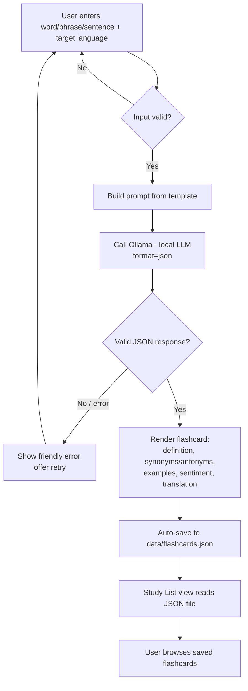

# EnglishHelper workflow

The user types a word, phrase, or sentence and picks a target language. Streamlit validates the input. The app builds a prompt and calls the local Ollama model with `format="json"`. The model returns one JSON object. The app parses and validates that object, renders a flashcard, and appends it to `data/flashcards.json`. The Study List tab reads that file.

The model runs only inside `lookup` and `call_model` in `llm_client.py`. JSON mode makes valid JSON more likely. `parse_flashcard` still checks the keys and types, and `lookup` retries once before showing an error.

