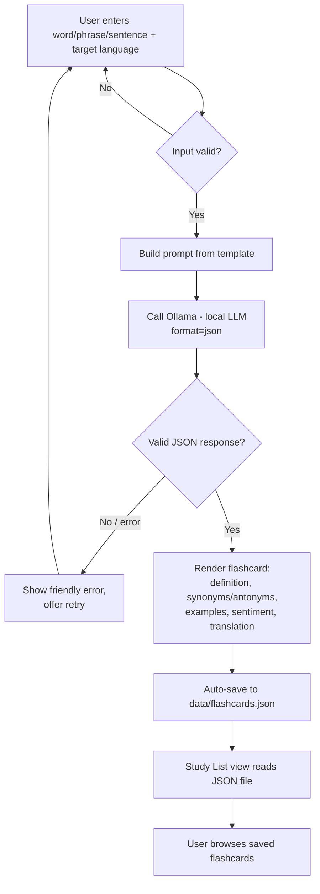

# EnglishHelper — CAP 942 Capstone Implementation Plan

---

## 1. Project Title

**EnglishHelper** — an automatic dictionary-to-flashcard vocabulary learning tool.

---

## 2. Project Summary

EnglishHelper is a Streamlit web app that turns a single word/phrase/sentence lookup into a complete study flashcard. The user types something in, a local open-source LLM (via Ollama) returns a definition, synonyms/antonyms, three example sentences, a sentiment/tone read, and (optionally) a translation into a language the user picks — and the result is automatically saved to a personal vocabulary list stored as JSON on disk, with zero extra clicks.

**Value proposition:** *One search does the work of a dictionary, a translator, and a flashcard app combined — so building a vocabulary habit stops requiring three tools and a manual step you'll eventually skip.*

---

## 3. Problem Statement

- **Problem:** Vocabulary learners juggle a dictionary, a translator, and a flashcard app to fully learn one word — and manually re-typing that word into a flashcard app is the exact step where most people quit the habit.
- **Why it matters:** Flashcard-based spaced repetition is one of the most effective ways to retain new vocabulary, but only if cards actually get made. Removing the manual-entry friction is the single highest-leverage fix.
- **Intended users:** ESL/EFL learners, exam-prep students (TOEFL/IELTS/GRE), immigrants building everyday vocabulary, and casual readers who hit unfamiliar words.

---

## 4. Capstone Requirement Alignment

| Capstone Requirement | How EnglishHelper Meets It | Evidence / Deliverable |
|---|---|---|
| Use one open-source LLM | Ollama running Llama 3.2 (3B) or Mistral locally | `ollama list` output + `llm_client.py` calling `localhost:11434` |
| Accept user input | Streamlit text input for word/phrase/sentence + language selector | `app.py` input widgets |
| Produce LLM-generated output | Definition, synonyms/antonyms, 3 examples, sentiment, translation generated in one structured LLM call | Rendered flashcard in the UI + saved JSON record |
| Run as a small web app | Built with Streamlit | `streamlit run app.py` |
| Database (if retrieval/memory features) | Not required — flashcards persist as a local JSON file, no retrieval/RAG in MVP | `data/flashcards.json` |
| No paid APIs | 100% local inference via Ollama; no external API keys | `requirements.txt` / `pyproject.toml` with no paid SDKs |
| Documentation within code | Docstrings + inline comments on every function | Source files |
| Workflow diagram | Mermaid diagram in Section 7 and in final docs | `docs/workflow.md` |
| GitHub deployment with instructions | README with setup/run instructions | Public/private GitHub repo |

---

## 5. Project Scope

### MVP (must-have, buildable in 1–2 weeks)
1. Text input for a word, phrase, or sentence.
2. One structured LLM call returning: definition, part of speech, synonyms, antonyms, 3 example sentences, sentiment/tone label.
3. User-selectable target language for translation (dropdown of a handful of languages), included in the same LLM call.
4. Auto-save every successful lookup as a flashcard to a local JSON file (dedupe by word+language).
5. A "Study List" view that lists saved flashcards and lets the user open one to review.
6. Basic input validation and error handling (empty input, Ollama not running, malformed model response).

### Explicitly out of scope for MVP
- Spaced-repetition scheduling (SM-2 algorithm, due dates) — just a flat list for now.
- User accounts / multi-user support.
- Audio pronunciation.
- Vector search or RAG (not needed — there's no document corpus to retrieve from).
- Mobile app / browser extension.

### Optional enhancements (only after MVP works end-to-end)
- Simple spaced-repetition ("study today" vs "seen") using a `last_reviewed` + `interval_days` field already stored in the JSON.
- Export flashcards to Anki-compatible CSV.
- Swap JSON for SQLite if the list grows large (schema is a natural 1:1 mapping).
- Cache repeated lookups to avoid re-calling the LLM for the same word.

---

## 6. Recommended Technology Stack

| Category | Choice | Why |
|---|---|---|
| Open-source LLM | **Llama 3.2 (3B-instruct)** via Ollama, with **Mistral 7B** as a fallback if 3.2 gives weak JSON formatting | 3B is fast enough for a snappy UI on a laptop; instruct-tuned models follow structured-output instructions more reliably |
| Model runner | **Ollama** | Simplest local LLM runner on macOS; one-line install, built-in JSON mode (`format="json"`), REST API on `localhost:11434` |
| Python LLM client | `ollama` Python package (thin wrapper) or raw `requests` to the REST API | `ollama` package is less code; `requests` is more transparent for learning — plan uses `ollama` package with fallback notes |
| Application framework | **Streamlit** | Matches your stated preference; fastest path to a usable UI with almost no frontend code |
| Storage | **JSON file** (`data/flashcards.json`) | You do not have retrieval/RAG features, so a full database is unnecessary complexity; JSON is trivial to read/write/inspect and matches your choice |
| Dependency management | **uv** | Fast, modern, single-file lockfile; works cleanly on macOS |
| Dev tools | VS Code, `ollama` CLI, `black`/`ruff` (optional formatting) | Standard, free, macOS-friendly |
| Testing | `pytest` for the non-UI logic (validation, JSON parsing, storage functions) | Keeps LLM-calling code separate and testable |

**Hardware considerations:** Ollama + a 3B model runs comfortably on 16 GB RAM Macs (Apple Silicon especially, via Metal acceleration). If responses feel slow, drop to a smaller quantized model (e.g., `llama3.2:1b`) — same code, just change the model name in one config constant.

---

## 7. Application Workflow

**Flow:** user types a word/phrase/sentence and picks a target language → Streamlit validates the input → the app builds a prompt and calls the local Ollama model with `format="json"` → the model returns a single JSON object with all fields → the app parses/validates that JSON → renders it as a flashcard in the UI → the same record is appended to `data/flashcards.json` → the Study List view reads that file to display saved cards.



The LLM is used exactly once per lookup, at step **D**, and is the only component that generates content — everything else is plumbing, validation, and display.

---

## 8. Application Architecture

**Major components:**

1. **UI layer (`app.py`)** — Streamlit page(s): lookup form, flashcard display, Study List view. Responsibility: collect input, call the service layer, render results. No LLM or file-I/O calls directly in here — it should only call functions from the other modules.
2. **LLM client (`llm_client.py`)** — Owns the prompt template, the call to Ollama, and JSON-response parsing/validation. Responsibility: turn `(text, target_language)` into a validated Python dict, or raise a clear exception.
3. **Storage layer (`storage.py`)** — Owns reading/writing `data/flashcards.json`. Responsibility: load all flashcards, append a new one (with dedupe logic), and return the list for display.
4. **Models/schema (`models.py`, optional but recommended)** — A small dataclass or `TypedDict` describing what a flashcard record looks like, shared by the LLM client and storage layer so both agree on field names.

**Data flow:** UI → LLM client → (validated dict) → UI renders it → UI → storage layer → JSON file. The UI never talks to Ollama or the filesystem directly.

**Where errors are handled:**
- Input validation (empty/too-long text) → in the UI layer, before calling the LLM client.
- Network/model errors (Ollama not running, timeout) → caught in `llm_client.py`, re-raised as a custom, friendly exception.
- Malformed JSON from the model → caught in `llm_client.py` with a retry-once strategy before failing.
- File I/O errors (corrupt JSON, missing file) → caught in `storage.py`, with a safe fallback (start from an empty list).
- The UI layer is the only place that turns exceptions into user-facing messages — lower layers should raise, not print or silently swallow.

---

## 9. Proposed Project Structure

```
english-helper/
├── app.py                  # Streamlit UI — lookup form + flashcard display + study list
├── llm_client.py           # Prompt template, Ollama call, JSON parsing/validation
├── storage.py               # Load/save/dedupe flashcards.json
├── models.py                 # Flashcard data shape (dataclass/TypedDict), shared by the above
├── config.py                  # Model name, Ollama host, supported languages list, constants
├── data/
│   └── flashcards.json        # Created at runtime — not committed with real user data
├── tests/
│   ├── test_storage.py        # Unit tests for load/save/dedupe logic
│   └── test_llm_client.py     # Unit tests for prompt building + JSON validation (mocked model calls)
├── docs/
│   └── workflow.md              # Exported/expanded version of the Mermaid diagram + architecture notes
├── pyproject.toml               # uv-managed dependencies
├── README.md                     # Setup, run instructions, examples
└── .gitignore                     # Exclude data/flashcards.json, .venv, etc.
```

I am **not** writing these files for you — this structure is your map. Each file's *purpose* is defined above; the *content* is what you build in the milestones below.

---

## 10. Step-by-Step Development Milestones

> Build bottom-up: get the LLM call working in isolation first, then storage, then wire the UI last. Do not start Streamlit until Milestones 1–3 work from the terminal.

### Milestone 0 — Environment Setup
- **Learning objective:** Get a local LLM responding to a prompt from Python.
- **Concepts to review:** what a local LLM runner does; REST APIs; virtual environments.
- **Tasks:** Install Ollama on macOS; `ollama pull llama3.2`; initialize the project with `uv init` and `uv add ollama streamlit`; confirm `ollama run llama3.2 "hello"` works in the terminal.
- **Coding exercise:** Write a 5-line script that sends one prompt to Ollama and prints the raw response.
- **Testing checkpoint:** Script prints a coherent English sentence back.
- **Acceptance criteria:** `uv run python -c "..."` calls Ollama and returns text without errors.
- **Common mistakes:** Forgetting Ollama's background service isn't running (`ollama serve`); pulling a model that's too large for available RAM.
- **What you build yourself:** The environment and the first smoke-test script.
- **How you'll know it works:** You see real model output, not a connection error.

### Milestone 1 — Basic LLM Call Function
- **Learning objective:** Wrap a single LLM call in a reusable Python function.
- **Concepts to review:** functions with typed parameters/return values; separating "call the model" from "use the result."
- **Tasks:** In `llm_client.py`, write a function that takes a plain string and returns the model's raw text response (no JSON structure yet).
- **Coding exercise:** Call your function with 3 different words and print results.
- **Testing checkpoint:** Function returns non-empty text for all 3 inputs.
- **Acceptance criteria:** Function has a docstring, type hints, and doesn't hardcode the input word.
- **Common mistakes:** Putting `print()` calls inside the function instead of returning values (makes it untestable).
- **What you build yourself:** The function signature, the Ollama call, and the return logic.
- **How you'll know it works:** `pytest`-free manual test in the terminal shows sensible text for each word.

### Milestone 2 — Structured JSON Output
- **Learning objective:** Get the LLM to return a *parseable* structured object instead of free text, in one call.
- **Concepts to review:** JSON, Ollama's `format="json"` option, prompt engineering for structured output.
- **Tasks:** Design your prompt template (see Section 12) requesting definition, part of speech, synonyms, antonyms, sentiment, and translation. Parse the response with `json.loads()`. Validate that expected keys exist.
- **Coding exercise:** Run the same word through your function twice — confirm the shape of the returned dict is identical both times, even if the content isn't.
- **Testing checkpoint:** No `KeyError` or `json.JSONDecodeError` on at least 5 different test words.
- **Acceptance criteria:** Function raises a custom exception (not a crash) on malformed JSON, and retries once before giving up.
- **Common mistakes:** Trusting the model to *always* return valid JSON — it won't, 100% of the time. Always validate.
- **What you build yourself:** The prompt template, JSON parsing, and validation/retry logic.
- **How you'll know it works:** You can reliably get a dict with all expected keys for common words.

### Milestone 3 — Example Sentences + Translation
- **Learning objective:** Extend the structured prompt to include 3 usage examples and a translation field, driven by a user-selected language.
- **Concepts to review:** parameterizing a prompt template with an extra variable (target language).
- **Tasks:** Add `target_language` as a function parameter; update the prompt template; extend validation to check for an `examples` list of length 3.
- **Coding exercise:** Call the function with the same word but two different target languages — confirm the translation field changes accordingly.
- **Testing checkpoint:** `examples` is always a list; translation field is present when a language is given.
- **Acceptance criteria:** Passing an unsupported/empty language doesn't crash the function.
- **Common mistakes:** Assuming the model always returns exactly 3 examples — validate the count, don't assume it.
- **What you build yourself:** The extended prompt and validation for the new fields.
- **How you'll know it works:** Structured dict now includes correctly-shaped `examples` and `translation` fields.

### Milestone 4 — Flashcard Storage
- **Learning objective:** Persist flashcards to a local JSON file safely.
- **Concepts to review:** file I/O, `json.dump`/`json.load`, handling a missing/corrupt file.
- **Tasks:** In `storage.py`, write `load_flashcards()` and `save_flashcard(card)`. Dedupe on `(word, target_language)` — update in place instead of duplicating.
- **Coding exercise:** Save 3 flashcards, then save a duplicate of one — confirm the file still has only 3 entries (updated, not doubled).
- **Testing checkpoint:** Write a `pytest` test using a temp file path that checks load/save/dedupe behavior.
- **Acceptance criteria:** Storage functions never assume the file exists; they create it on first save.
- **Common mistakes:** Overwriting the whole file incorrectly and losing prior entries; not handling the "file doesn't exist yet" case.
- **What you build yourself:** The load/save/dedupe functions and their tests.
- **How you'll know it works:** `pytest tests/test_storage.py` passes.

### Milestone 5 — Streamlit UI
- **Learning objective:** Wire the LLM client and storage layer into a usable web UI.
- **Concepts to review:** Streamlit widgets (`st.text_input`, `st.selectbox`, `st.button`), `st.session_state` if needed, basic layout.
- **Tasks:** Build the lookup form (text input + language dropdown + submit button); on submit, call `llm_client`, render the flashcard, call `storage.save_flashcard`. Build a second view/tab listing saved flashcards from `storage.load_flashcards()`.
- **Coding exercise:** Add a loading spinner (`st.spinner`) while the LLM call runs.
- **Testing checkpoint:** Manually look up 5 different words/phrases/sentences through the UI and confirm they appear in the Study List.
- **Acceptance criteria:** UI never calls Ollama or touches the file system directly — only through your two modules.
- **Common mistakes:** Putting business logic (parsing, saving) inside Streamlit callback code, making it untestable.
- **What you build yourself:** The whole `app.py` layout and event wiring.
- **How you'll know it works:** You can run `streamlit run app.py` and complete the full user flow without errors.

### Milestone 6 — Error Handling & Testing Pass
- **Learning objective:** Make the app fail gracefully.
- **Tasks:** Add `try/except` around the LLM call in the UI layer with a friendly `st.error()` message; handle empty input; handle Ollama-not-running. Run through the 5+ test cases in Section 13.
- **Testing checkpoint:** Stop the Ollama service and confirm the app shows a clear error instead of crashing.
- **Acceptance criteria:** No unhandled exception reaches the Streamlit UI in any of your test cases.
- **What you build yourself:** The error-handling branches and their messages.
- **How you'll know it works:** All 5+ test cases in Section 13 behave as expected.

### Milestone 7 — Documentation, Diagram, GitHub
- **Tasks:** Write the README (Section 15), export/finalize the workflow diagram, push to GitHub with the naming convention required by the syllabus.
- **Acceptance criteria:** A stranger could clone the repo and run the app using only the README.

### Milestone 8 — Presentation Prep
- **Tasks:** Build the 5–10 minute walkthrough per Section 16; rehearse the live demo end-to-end at least twice.

---

## 11. Guided Code Examples

These are isolated, incomplete snippets to teach one concept each — **not** a working app. Each has a `TODO` you must complete.

### Example A — Validating User Input
```python
def validate_lookup_input(text: str) -> str:
    """Clean and validate the word/phrase/sentence the user typed."""
    cleaned = text.strip()
    if not cleaned:
        raise ValueError("Please enter a word, phrase, or sentence.")
    # TODO: decide on a reasonable max length (a sentence, not an essay)
    # and raise ValueError if cleaned exceeds it.
    if len(cleaned) > 500:  # placeholder limit — reconsider this
        raise ValueError("Input is too long.")
    return cleaned
```
**Explanation:** Keeps validation separate from the UI so it's testable without launching Streamlit. **Practice task:** write a `pytest` test that checks an empty string raises `ValueError`.

### Example B — Calling Ollama with Structured Output
```python
import ollama
import json

def call_llm(prompt: str, model: str = "llama3.2") -> dict:
    """Send a prompt to the local model and return the parsed JSON dict."""
    response = ollama.chat(
        model=model,
        messages=[{"role": "user", "content": prompt}],
        format="json",  # asks Ollama to constrain output to valid JSON
    )
    raw_text = response["message"]["content"]
    # TODO: wrap this in try/except json.JSONDecodeError and decide
    # what your function should do when parsing fails (retry? raise?).
    return json.loads(raw_text)
```
**Explanation:** `format="json"` nudges the model toward valid JSON, but doesn't guarantee it — you still must parse defensively. **Practice task:** call this with a prompt that has no JSON instructions at all, and observe what happens.

### Example C — Prompt Template With Placeholders
```python
PROMPT_TEMPLATE = """You are a vocabulary assistant. Return ONLY valid JSON.

Word or phrase: {text}
Target language for translation: {target_language}

# TODO: list the exact JSON keys you require, e.g.:
# {{"definition": "...", "part_of_speech": "...", "synonyms": [...],
#   "antonyms": [...], "examples": ["...", "...", "..."],
#   "sentiment": "...", "translation": "..."}}
"""

def build_prompt(text: str, target_language: str) -> str:
    return PROMPT_TEMPLATE.format(text=text, target_language=target_language)
```
**Explanation:** Separating the template from the function that fills it makes it easy to iterate on prompt wording without touching your call logic. **Practice task:** fill in the TODO with your real schema, then run Example B against it for 3 different words.

### Example D — Saving a Flashcard (Dedupe Pattern)
```python
import json
from pathlib import Path

FLASHCARDS_PATH = Path("data/flashcards.json")

def save_flashcard(card: dict) -> None:
    """Append a flashcard, replacing any existing entry for the same word+language."""
    cards = []
    if FLASHCARDS_PATH.exists():
        cards = json.loads(FLASHCARDS_PATH.read_text())
    # TODO: replace this naive append with dedupe logic:
    # find an existing card with the same (word, target_language) and
    # overwrite it in place instead of appending a duplicate.
    cards.append(card)
    FLASHCARDS_PATH.parent.mkdir(exist_ok=True)
    FLASHCARDS_PATH.write_text(json.dumps(cards, indent=2))
```
**Explanation:** Shows the load-modify-save pattern common to simple JSON persistence. **Practice task:** write the dedupe logic, then write a test that saves the same word twice and asserts the file still has one entry.

### Example E — Handling One Common Error
```python
class LLMUnavailableError(Exception):
    """Raised when the local model can't be reached."""
    pass

def safe_call_llm(prompt: str) -> dict:
    try:
        return call_llm(prompt)  # from Example B
    except ConnectionError as exc:
        # TODO: is ConnectionError actually what the ollama package raises?
        # Check the library's docs/source and catch the correct exception type.
        raise LLMUnavailableError(
            "Could not reach Ollama. Is it running? Try: ollama serve"
        ) from exc
```
**Explanation:** Translates a low-level error into a message your UI layer can show the user. **Practice task:** stop Ollama, trigger this path, and confirm your Streamlit UI shows a friendly message rather than a stack trace.

---

## 12. Prompt-Engineering Plan

- **Purpose of the system/instruction prompt:** constrain the model to a single, strictly-shaped JSON object so downstream code never has to guess field names or formats.
- **Information the user provides:** the word/phrase/sentence, and the target language for translation.
- **Expected response format:** a single JSON object with fixed keys — no prose before/after it. Example keys: `definition`, `part_of_speech`, `synonyms` (list), `antonyms` (list), `examples` (list of exactly 3 strings), `sentiment` (short label like "neutral"/"positive"/"negative"), `translation` (string in the target language).
- **Example prompt template with placeholders:**
  ```
  You are a vocabulary assistant. Return ONLY a valid JSON object, no extra text.

  Input: "{text}"
  Target language: "{target_language}"

  Return JSON with exactly these keys:
  definition, part_of_speech, synonyms, antonyms, examples (list of 3),
  sentiment, translation
  ```
- **Methods for reducing unclear/unsupported responses:**
  - Use Ollama's `format="json"` mode to bias toward valid JSON.
  - Explicitly state "ONLY valid JSON, no extra text" — models often add commentary otherwise.
  - Validate the parsed dict has all required keys before trusting it; retry once with a slightly stricter reminder if it fails.
  - Keep the instruction short and example-free at first — add a one-shot example in the prompt only if you see recurring formatting problems.

---

## 13. Testing Plan

**Unit/component tests (`pytest`, no live LLM calls — mock `call_llm`):**
- `validate_lookup_input` rejects empty/whitespace-only input.
- `save_flashcard` dedupes correctly on repeated word+language.
- JSON-parsing/validation logic rejects a response missing required keys.

**End-to-end tests (manual, through the running app):**

| # | Test Case | Expected Behavior |
|---|---|---|
| 1 | Common noun, e.g. "bicycle" | Full flashcard with definition, synonyms, 3 examples, sentiment, translation |
| 2 | Word with multiple parts of speech, e.g. "run" | `part_of_speech` reflects at least one clear sense; examples show usage |
| 3 | Full sentence with idiomatic meaning, e.g. "break the ice" | Definition addresses the idiom's meaning, not a literal word-by-word gloss |
| 4 | Empty input (submit with nothing typed) | UI shows a validation message, no LLM call is made |
| 5 | Ollama service stopped | UI shows a friendly "model unavailable" error, app doesn't crash |
| 6 | Very long input (a paragraph) | Either rejected by validation, or handled without crashing |
| 7 | Non-English input, e.g. a Spanish word | Model still attempts a reasonable definition/translation; note any limitations in your docs |

**Evaluating LLM output quality (simple, non-automated method):** keep a short manual log (a markdown table is fine) of 10–15 lookups with a 1–3 rating for "definition accuracy" and "example sentence usefulness." This gives you evidence for the "challenges & lessons learned" section without building a formal eval harness.

---

## 14. Privacy, Security, Accessibility, and Responsible-AI Considerations

- **Risks:** the LLM can hallucinate incorrect definitions, mistranslations, or misleading sentiment labels; there is no fact-checking layer.
- **Project limitations:** this is a learning aid, not an authoritative dictionary or certified translation tool; sentiment analysis on single words/short phrases is inherently coarse.
- **Ways to reduce risk:** show a small "AI-generated — verify important translations" note in the UI; keep example sentences clearly labeled as generated, not sourced from a corpus.
- **Data handled:** only the words/phrases the user looks up, stored locally in a JSON file — no accounts, no data leaves the machine (all inference is local).
- **Accessibility:** use Streamlit's built-in label support for form fields, sufficient color contrast for sentiment labels, and avoid relying on color alone to convey sentiment (pair with a text label).
- **Claims the app should not make:** it should not claim clinical-grade sentiment analysis, certified/professional translation accuracy, or exam-score guarantees for TOEFL/IELTS/GRE prep.

---

## 15. Documentation and GitHub Plan

**README sections:**
1. Project overview and problem statement (short version of Sections 2–3).
2. Screenshot or GIF of the app in use.
3. Setup instructions (macOS, Ollama install, `uv sync`, model pull).
4. How to run (`streamlit run app.py`).
5. Example input/output (one full flashcard example, shown as text).
6. Known limitations.
7. Credits/tools used.

**Dependency documentation:** `pyproject.toml` (managed by `uv`) lists exact packages; mention in the README that Ollama itself is installed separately (not a Python package).

**GitHub submission checklist:**
- [ ] Repo named per the `FirstName_LastName_CapstoneAI` convention (or a matching top-level folder if repo naming can't match exactly).
- [ ] README with full setup/run instructions.
- [ ] `data/flashcards.json` excluded via `.gitignore` (don't commit personal lookup history).
- [ ] `docs/workflow.md` with the Mermaid diagram.
- [ ] No paid API keys anywhere in the repo or `.env` committed by mistake.
- [ ] Code runs from a clean clone using only the README steps.

---

## 16. Presentation Plan

**Suggested structure (5–10 minutes):**
1. Problem & motivation (1 min) — the multi-tool vocabulary problem.
2. Live demo (3–4 min) — look up a word, a phrasal verb, and a full sentence; show the Study List.
3. Workflow diagram walkthrough (1–2 min) — point to where the LLM is used and why JSON mode matters.
4. Tools used (1 min) — Ollama, Streamlit, uv, JSON storage.
5. Challenges & lessons learned (1–2 min) — e.g., getting reliable JSON out of the model, dedupe logic, error handling.
6. Next steps (30 sec–1 min) — spaced repetition, SQLite migration, Anki export.

**Live demo sequence:** empty app → look up "bicycle" (simple case) → look up "break the ice" (idiom, shows definition quality) → switch target language and look up another word (shows translation) → open Study List to show persistence → (optional) stop Ollama briefly to show graceful error handling.

---

## 17. Suggested Timeline (1–2 Weeks, Compressed)

| Day | Focus |
|---|---|
| 1 | Milestone 0 (environment) + start Milestone 1 (basic LLM call) |
| 2 | Finish Milestone 1, complete Milestone 2 (structured JSON output) |
| 3 | Milestone 3 (examples + translation) |
| 4 | Milestone 4 (storage) + tests |
| 5–6 | Milestone 5 (Streamlit UI) |
| 7 | Milestone 6 (error handling + run all test cases from Section 13) |
| 8 | Milestone 7 (README, workflow doc, GitHub push) |
| 9 | Milestone 8 (presentation prep, rehearse demo) |
| 10 (buffer) | Fix anything discovered while rehearsing; polish |

Test and confirm each milestone works **before** moving to the next — don't start the UI (Milestone 5) until Milestones 1–4 work independently from the terminal.

---

## 18. Definition of Done

- [ ] **Proposal (60 pts):** problem statement, tool choices, and workflow plan are written up and match what was actually built.
- [ ] **Functional application (210 pts):**
  - [ ] App runs end-to-end via `streamlit run app.py` without errors.
  - [ ] Local open-source LLM (Ollama) performs all generation: definition, synonyms/antonyms, examples, sentiment, translation.
  - [ ] Code is split across `app.py` / `llm_client.py` / `storage.py` / `models.py` / `config.py` with docstrings and comments.
  - [ ] Scope matches the MVP defined in Section 5 — nothing half-built left in the app.
- [ ] **Documentation & presentation (30 pts):**
  - [ ] README with full setup/run instructions is complete.
  - [ ] Workflow diagram (Mermaid) accurately reflects the final app.
  - [ ] Presentation rehearsed and covers all required elements from Section 16.
- [ ] All 5+ test cases from Section 13 pass or have documented known limitations.
- [ ] No paid APIs, no ML/DL training, runs entirely locally.
- [ ] Repo pushed to GitHub with correct naming convention and clean `.gitignore`.
