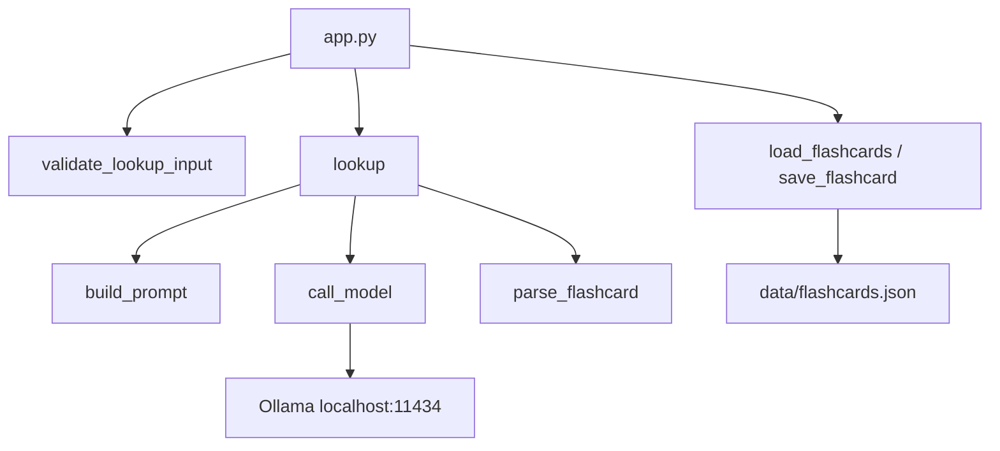

# EnglishHelper Milestone Implementation Plan

Build EnglishHelper bottom-up from a local Ollama smoke test through structured lookups, JSON flashcard storage, a Streamlit UI, error handling, and capstone docs — one milestone at a time, each verified before the next starts.

Build in the existing workspace `/Users/baygrove/Desktop/EnglishHelper`. Follow [implementation_plan.md](implementation_plan.md) exactly: local Ollama only, JSON storage, no accounts, no spaced repetition, no paid APIs. Do not start Streamlit until Milestones 1–4 pass from the terminal.

## Milestone checklist

- [ ] Milestone 0: Ollama + uv project + smoke script
- [ ] Milestone 1: `call_model` returns raw text with typed errors
- [ ] Milestone 2: prompt, JSON parse, validate, retry-once lookup
- [ ] Milestone 3: 3 examples + target language parameterization
- [ ] Milestone 4: JSON load/save/dedupe + pytest
- [ ] Milestone 5: Streamlit lookup and Study List wired only through modules
- [ ] Milestone 6: UI error paths + Section 13 manual cases + quality log
- [ ] Milestone 7: README, workflow diagram, GitHub checklist
- [ ] Milestone 8: presentation notes and two demo rehearsals

## Locked decisions

- **Model:** `llama3.2` via the `ollama` Python package. `config.py` holds the model name so a fallback (`mistral`, or `llama3.2:1b` if RAM is tight) is a one-line change.
- **Public LLM API:** low-level `call_model(prompt) -> str`, plus `lookup(text, target_language) -> dict` that builds the prompt, calls in JSON mode, validates, and retries once.
- **Storage API:** `load_flashcards(path=None)` and `save_flashcard(card, path=None)`. Default path is `data/flashcards.json`. Tests pass `tmp_path` so they never touch real data.
- **UI rule:** `app.py` only calls `validate_lookup_input`, `lookup`, and the storage functions. It does not import `ollama` or open files.
- **Languages (dropdown):** Spanish, French, German, Portuguese, Chinese, Japanese, Korean, Arabic. Default: Spanish. An empty language passed to `lookup` falls back to that default and does not raise. A language outside the list is still sent to the model (the function must not crash).
- **Input limit:** 300 characters after `strip` (a sentence, not the 500-character placeholder in Example A).
- **Dedupe key:** `(word.casefold(), target_language.casefold())`. A repeat overwrites that entry in place and keeps its position in the list.



## Shared contracts (introduced as milestones need them)

`config.py` — constants only:

- `MODEL_NAME = "llama3.2"`
- `OLLAMA_HOST = "http://localhost:11434"`
- `DEFAULT_LANGUAGE = "Spanish"`
- `SUPPORTED_LANGUAGES` (the eight names above)
- `MAX_INPUT_LENGTH = 300`
- `FLASHCARDS_PATH = Path("data/flashcards.json")`
- `REQUIRED_FIELDS` for the model payload

`models.py` — one `@dataclass` `Flashcard` with: `word`, `target_language`, `definition`, `part_of_speech`, `synonyms`, `antonyms`, `examples`, `sentiment`, `translation`, `created_at` (ISO-8601 UTC). Methods: `to_dict()` / `from_dict()`. `validate_lookup_input(text: str) -> str` lives here (Example A): strip, reject empty, reject over 300 chars with `ValueError`.

Model JSON shape (not the stored card — storage adds `word`, `target_language`, `created_at`):

```python
{
  "definition": str,
  "part_of_speech": str,
  "synonyms": list[str],
  "antonyms": list[str],
  "examples": list[str],  # exactly 3 after validation
  "sentiment": str,
  "translation": str,
}
```

`llm_client.py` exceptions, raised (never printed):

- `LLMUnavailableError` — Ollama down, timeout, or model missing
- `MalformedLLMResponseError` — invalid JSON or schema after one retry

During Milestone 0, confirm which exception the installed `ollama` package raises when the daemon is down (`httpx.ConnectError` is the likely one). Catch that type plus `TimeoutException` / `ConnectionError`, and `ollama.ResponseError` for a missing model. Chain with `raise ... from exc`.

## Milestone 0 — Environment setup

**Done when:** `ollama run llama3.2 "hello"` prints English, and a Python smoke script prints a coherent sentence.

1. Install Ollama on macOS and start it (`ollama serve` if `localhost:11434` is closed).
2. `ollama pull llama3.2`. If the pull or a reply is too slow for 16 GB RAM, pull `llama3.2:1b` and set `MODEL_NAME` to that. Do not switch models silently later.
3. From the workspace: `uv init`, then `uv add ollama streamlit` and `uv add --dev pytest`. Set `requires-python >= 3.11`.
4. Add `.gitignore`: `.venv/`, `__pycache__/`, `.pytest_cache/`, `.ruff_cache/`, `data/flashcards.json`, `data/*.bak`, `.env`, `.DS_Store`.
5. Add `scripts/smoke_ollama.py`: about five lines that call `ollama.chat` with `MODEL_NAME` and print `message.content`. No JSON mode yet.

**Check:** `uv run python scripts/smoke_ollama.py` returns text, not a connection error.

## Milestone 1 — Basic LLM call

**Done when:** a terminal loop prints non-empty text for three different words, and the function returns instead of printing.

In `llm_client.py`:

```python
def call_model(prompt: str, *, json_mode: bool = False) -> str:
    """Send one prompt to the local model and return the raw message text."""
```

- Use `ollama.Client(host=OLLAMA_HOST).chat(...)`.
- Pass `format="json"` only when `json_mode=True`.
- Docstring, type hints, no hardcoded lookup word, no `print`.
- Map connection/timeout/missing-model failures to `LLMUnavailableError`.

Manual check (not pytest): call `call_model` with three short prompts such as `Define: bicycle`, `Define: run`, `Define: serendipity`.

## Milestone 2 — Structured JSON output

**Done when:** five words each return a dict with every required key, and bad JSON raises `MalformedLLMResponseError` after exactly one retry.

Add to `llm_client.py`:

- `PROMPT_TEMPLATE` from Section 12, filled by `build_prompt(text, target_language) -> str`. Require keys: `definition`, `part_of_speech`, `synonyms`, `antonyms`, `examples`, `sentiment`, `translation`. Say "ONLY a valid JSON object, no extra text." For this milestone, examples and translation are requested but length/language checks wait until Milestone 3. Pass `target_language=DEFAULT_LANGUAGE` from manual calls.
- `parse_flashcard(raw: str) -> dict`: `json.loads`, then require every key. `definition`, `part_of_speech`, `sentiment`, `translation` must be non-empty strings. `synonyms` and `antonyms` must be lists of strings (empty list is valid). On failure raise `MalformedLLMResponseError`.
- `lookup(text, target_language) -> dict`: `build_prompt` → `call_model(..., json_mode=True)` → `parse_flashcard`. On `json.JSONDecodeError` or `MalformedLLMResponseError`, call the model **once** more with the original prompt plus a stricter reminder that names the keys and types. If the second attempt fails, raise `MalformedLLMResponseError`.

`tests/test_llm_client.py` mocks `call_model` (no live Ollama):

- Valid JSON dict passes `parse_flashcard`.
- Missing key, non-JSON text, and a string where a list is required each raise `MalformedLLMResponseError`.
- `lookup` calls the model a second time when the first payload is invalid, and does not call a third time.

Manual check: five words (`bicycle`, `run`, `ephemeral`, `however`, `bank`) through `lookup` with no `KeyError` or `JSONDecodeError`.

## Milestone 3 — Examples and translation

**Done when:** the same word in two languages changes `translation`, `examples` is always three strings, and an empty language does not crash.

Extend `parse_flashcard`:

- `examples` must be a list of strings.
- More than 3: keep the first 3.
- Fewer than 3, or non-strings: treat as malformed so `lookup` can retry once, then raise.
- Empty/whitespace `target_language`: substitute `DEFAULT_LANGUAGE` before building the prompt.
- Unknown language string: strip it and pass it through.

Manual check: `lookup("bicycle", "Spanish")` vs `lookup("bicycle", "French")`. Translation text should differ. Then `lookup("bicycle", "")` and `lookup("bicycle", "Klingon")` should return a dict, not raise on the language argument itself.

Add mocked tests: two examples fails validation; four examples becomes three; blank language uses Spanish in `build_prompt`.

## Milestone 4 — Flashcard storage

**Done when:** `uv run pytest tests/test_storage.py` passes, including the duplicate-save case.

`storage.py`:

- `load_flashcards(path: Path | None = None) -> list[dict]`
  - Missing file → `[]`.
  - Corrupt JSON or a non-list root → rename the file to `flashcards.json.bak` (do not delete it) and return `[]`.
- `save_flashcard(card: dict, path: Path | None = None) -> list[dict]`
  - Require `word` and `target_language`.
  - Create `data/` on first save.
  - Load, replace the entry with the same casefolded `(word, target_language)`, otherwise append.
  - Write the full list with `json.dumps(..., indent=2)`.
  - Return the list just written.
- `card_from_lookup(word, target_language, payload) -> dict` in `models.py` merges the model payload with `word`, `target_language`, and `created_at`. On dedupe update, refresh content and set `updated_at`; keep the original `created_at` and list index.

`tests/test_storage.py` uses `tmp_path`:

- First save creates the file.
- Three distinct cards, then a duplicate word+language, leaves 3 entries and the updated definition.
- Different language for the same word is a second card.
- Case-only difference (`Bicycle` / `bicycle`) dedupes.
- Missing file loads as `[]`.
- Corrupt file loads as `[]` and leaves a `.bak`.

Also add `tests/test_models.py`: empty and whitespace-only input raises `ValueError`; a 301-character string raises; a normal sentence is returned stripped.

## Milestone 5 — Streamlit UI

**Done when:** `uv run streamlit run app.py` completes lookup → flashcard → Study List for several inputs, and `app.py` has no `ollama` import and no `Path`/`open` file access.

`app.py` layout:

- Title and one-line description.
- `st.tabs`: **Lookup** and **Study List**.
- Lookup: `st.text_input` (label "Word, phrase, or sentence"), `st.selectbox` of `SUPPORTED_LANGUAGES`, `st.button("Look up")`.
- On click: `validate_lookup_input`; on `ValueError`, `st.error` and return before any LLM call.
- `with st.spinner("Looking up..."):` call `lookup`, then `card_from_lookup`, then `save_flashcard`.
- Store the card in `st.session_state` so a rerun does not call the model again.
- Render the card: word, part of speech, definition, translation, sentiment as **text** (optional color alongside the word, never color alone), synonyms, antonyms, three examples.
- Study List: `load_flashcards()`, newest `created_at` first, one `st.expander` per card showing the same fields. Empty state: "No flashcards yet."

Manual check from Section 13 cases 1–3: `bicycle`, `run`, `break the ice`, plus two more (a phrase and a sentence). Each appears once in the Study List. Repeat `bicycle` in Spanish and confirm the list still has one Spanish card for that word.

## Milestone 6 — Error handling and test pass

**Done when:** every Section 13 case behaves as specified, and no traceback is the user-facing result.

In `app.py`, around `lookup` / `save_flashcard` only:

- `LLMUnavailableError` → `st.error` with the exception message (include "Is Ollama running?").
- `MalformedLLMResponseError` → `st.error` asking the user to try again.
- Unexpected `OSError` from storage → `st.error` that the study list could not be saved; do not crash the script.

Run and record:

- Common noun, polysemous word, idiom (cases 1–3).
- Empty submit: validation message, no model call (case 4). This is already guaranteed if `validate_lookup_input` runs first.
- Stop Ollama, submit a word: friendly unavailable error (case 5). Restart Ollama afterward.
- Paragraph over 300 characters: validation error, no model call (case 6).
- A Spanish word as input (case 7): app returns a card; note quality limits in the README later.

Add `docs/quality_log.md`: a markdown checklist table template for 10–15 lookups with 1–3 scores for definition accuracy and example usefulness. Fill it during this pass; it is evidence for the presentation, not an automated eval.

`uv run pytest` must still pass (mocked LLM tests plus storage and validation).

## Milestone 7 — Documentation and GitHub

**Done when:** a clean machine can follow `README.md` only: install Ollama, pull the model, `uv sync`, `uv run streamlit run app.py`.

`README.md` sections, in order: overview and problem; screenshot or GIF (capture after the UI works); macOS setup (`ollama` install, `ollama pull llama3.2`, `uv sync`); how to run; one full example card as text; known limitations (hallucinated definitions, coarse sentiment, not a certified translator, not an exam-score tool); credits (Ollama, Llama 3.2, Streamlit, uv). State that Ollama is installed outside Python.

`docs/workflow.md`: the Section 7 Mermaid diagram plus a short note that the LLM runs only inside `lookup` / `call_model`, and that JSON mode still requires `parse_flashcard`.

GitHub checklist from Section 15:

- Repo or top-level folder named `FirstName_LastName_CapstoneAI` (confirm the exact name before creating the remote).
- `.gitignore` already excludes `data/flashcards.json`.
- No `.env`, no API keys.
- Commit and push only when you ask. Do not force-push.

## Milestone 8 — Presentation prep

**Done when:** the live demo sequence has been rehearsed twice on a running app.

Speaker outline (5–10 minutes), kept in `docs/presentation.md`:

1. Problem (about 1 min) — dictionary + translator + flashcards, and the manual-entry drop-off.
2. Live demo (3–4 min) — empty Study List → `bicycle` → `break the ice` → change language and look up another word → open Study List. Optional: stop Ollama and show the friendly error, then restart it.
3. Workflow diagram (1–2 min) — point at the single LLM step and why JSON mode plus validation exists.
4. Tools (1 min) — Ollama, Streamlit, uv, JSON file.
5. Challenges (1–2 min) — unreliable JSON, dedupe, daemon-down errors. Use `docs/quality_log.md`.
6. Next steps (under 1 min) — spaced repetition via `last_reviewed` / `interval_days`, Anki CSV, SQLite. Do not build these.

## Out of scope until the definition of done is met

Spaced repetition, Anki export, SQLite, lookup cache, audio, accounts, RAG. Do not leave half-built controls for these in the UI.

## Definition of done

Matches Section 18: `streamlit run app.py` works end-to-end; all generation comes from local Ollama; modules are `app.py`, `llm_client.py`, `storage.py`, `models.py`, `config.py` with docstrings; MVP scope only; README, workflow diagram, and rehearsed presentation; Section 13 cases pass or are documented; pytest passes without live model calls; repo is pushable with a clean gitignore.
